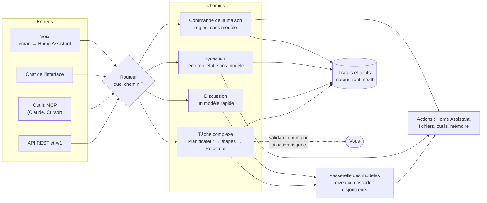

# Comprendre le moteur

> **En une phrase.** Le Moteur IA est un serveur Python qui reçoit une demande (texte, voix via Home Assistant,
> outil MCP, API), choisit le chemin **le moins cher qui suffit** (des règles sans modèle d'abord, puis un modèle rapide,
> puis une orchestration complète), agit, et trace chaque appel avec son coût.

Cette page explique ce qui se passe entre l'envoi d'une demande et la réponse, puis fait la visite de l'interface. Elle
ne demande aucune installation préalable pour être lue ; pour essayer, voir [01 Installer](01_installer.md). Le détail
technique de l'architecture est dans [`docs/ARCHITECTURE.md`](../ARCHITECTURE.md) (cliché de juin 2026), celui de l'API dans
[`docs/API_REFERENCE.fr.md`](../API_REFERENCE.fr.md).

Un seul nom : **Moteur IA**. Vous croiserez aussi `vromvrom-engine` (le dépôt public) et `tab5-engine` (nom interne
du serveur, visible dans `/healthz` et dans le nom du serveur MCP). C'est le même logiciel.

---

## 1. Ce que le moteur fait, en trois usages

| Usage | Ce que ça donne | Ce qu'il faut |
|---|---|---|
| **Domotique vocale** | « Okay Nabu, allume le salon » sur un écran : Home Assistant transcrit la voix, le moteur comprend et agit, la réponse est dite et affichée. | Home Assistant, un écran ou un satellite vocal : [04](04_maison_et_voix.md) |
| **Une porte unique vers beaucoup de modèles** | Le moteur choisit le modèle, bascule en cas de panne, exploite les quotas gratuits, compte les jetons et les dollars. Il expose aussi une API compatible OpenAI (`/v1`) pour vos outils. | Une clé de fournisseur au minimum |
| **Agents et automatisation** | Une demande complexe est découpée en plan, exécutée par étapes avec des outils, relue, avec validation humaine avant les actions risquées. Des boucles de fond consolident la mémoire ou surveillent. | Clés de modèles ; prudence sur les coûts : [05 Exploiter](05_exploiter.md) |

Le moteur fonctionne **sans Home Assistant** : le chat, l'API, les agents et le serveur MCP n'en dépendent pas.

---

## 2. Vue d'ensemble



---

## 3. Le trajet d'une demande

Toute demande arrive par `POST /api/execute` (ou `/api/execute/stream` pour un flux d'événements). Elle porte un
`user_prompt` et une `source` (`type` et `mode`) qui disent d'où elle vient (`api/routes/agents.py`,
`core/source_router.py`) :

| `source.type` | Origine |
|---|---|
| `tab5` | écran Tab5 |
| `whatsapp` | message WhatsApp |
| `ide` | éditeur de code |
| `voice` | voix |
| `web` | interface web ou script |
| `unknown` | autre |

Le **mode** (`ha`, `chat`, `files`, `default`) oriente le traitement : `ha` est l'agent domotique, `chat` la discussion.

### 3.1 Quatre chemins, du plus simple au plus lourd

| Chemin | Exemple | Modèle appelé ? | Où le régler |
|---|---|---|---|
| **Commande de la maison** | « Allume la lumière du salon. » | Non : catalogue de phrases (`ha_commands.json`), puis rapprochement approché des entités | `ha_commands.json` |
| **Question sur la maison ou le quotidien** | « Quelle heure est-il ? », « Quelle température dans le salon ? » | Non : lecture d'état, météo, horloge | rien à régler |
| **Discussion** | « Explique la différence entre un volet et un store. » | Oui, un modèle rapide, avec cascade de secours | `config.json` → `routing_policy.fast_path_providers` |
| **Tâche complexe** | « Analyse ces journaux et propose un correctif. » | Oui, plusieurs : Planificateur, Exécuteur, Relecteur | niveaux de modèles, agents, validation humaine |

L'ordre exact des raccourcis dans les modes vocaux est décrit, avec ses garde-fous, dans
[`docs/architecture/carte_decision_vocale.md`](../architecture/carte_decision_vocale.md). En résumé :

- mode `ha` : question d'état, réglage relatif de la clim, commande du catalogue, météo ou heure, puis routeur
  (rapprochement approché, puis classification par modèle) ;
- mode `chat` : commande, état, météo, heure ou date, spécialistes (web, agenda, fichiers), puis discussion par un
  modèle.

Deux garde-fous à connaître :

- **Une question n'est pas un ordre** : le test porte sur le texte brut reconnu.
- **La voix n'atteint pas le Planificateur** : les modes vocaux ne déclenchent pas l'orchestration complète.

Vous pouvez voir lequel de ces chemins une phrase prendrait **sans rien exécuter** avec
`POST /api/vocal/simulate` ([04](04_maison_et_voix.md), § 4). Essayé :

| Phrase | Mode | `chemin` rendu | Modèle requis ? |
|---|---|---|---|
| « allume la lumière du salon » | `ha` | `ha_command` (service `light.turn_on`, entité `light.living_room`) | non |
| « quelle heure est-il » | `chat` | `discussion_datetime` | non |
| « raconte-moi une blague » | `chat` | `discussion_chat` | oui |

### 3.2 Le routeur

`core/router.py` choisit d'abord par **mots-clés** (sans modèle) parmi 11 catégories : `casual_chat`,
`home_assistant`, `code_generation`, `database`, `files`, `analysis`, `sysadmin`, `deck_edge`, `calendar`, `email`,
`accounts`. Si les mots-clés hésitent :

- un **routeur appris** (scikit-learn) n'intervient que s'il a été entraîné et que le score de mots-clés est inférieur
  à 0,05 ; sans modèle entraîné, il est ignoré ;
- sinon un **petit modèle** classe la demande ; sous 0,7 de confiance (`MIN_LLM_CONFIDENCE`), la demande part au
  Planificateur.

**Garde de validation** (`MOTEUR_ROUTER_GARDE_HITL`, activé par défaut) : une demande qui ordonne d'agir ne prend pas
le raccourci, pour rester soumise à l'approbation (§ 7).

---

## 4. Choisir le modèle : niveaux, cascade, disjoncteurs

### 4.1 Fournisseurs et niveaux

- Un **fournisseur** (Gemini, DeepSeek, Anthropic, Mistral, Cerebras, OpenRouter…) s'active quand sa clé est dans le
  `.env`. Une clé absente : il est ignoré, sans erreur. Liste des variables : [03 Réglages](03_reglages.md).
- Le **catalogue** (`models_registry.db`, rempli par `seed_models_db.py` : 97 modèles lors de l'essai) décrit chaque
  modèle : fournisseur, prix, contexte, niveau.
- Les **niveaux** (`tiers`) sont `leger`, `moyen`, `fort` et `automatique`. La liste des modèles d'un niveau vient du
  **catalogue** (réglable dans l'écran **Modèles & routage**) ; `config.json["tiers"]` n'est qu'un filet de secours.
  `automatique` regroupe tous les modèles actifs. `routing_policy.excluded_models` retire des modèles du routage quel
  que soit le niveau.
- Chaque agent a son modèle ou son niveau dans `config.json` : `planner_model`, `executor_model`, `reviewer_model`,
  `ha_model`, `antigravity_model`.

### 4.2 La cascade

Pour un niveau, les modèles sont classés (score Elo par domaine, coût, quota restant, latence). Si le premier échoue,
le suivant prend le relais. Le score Elo est ajusté d'après les relectures (`elo_enabled`, vrai par défaut).

La **discussion rapide** (fast path) suit sa propre liste : `routing_policy.fast_path_providers`. Le repli du code
(`services/pipeline_service.py`, lignes 83-88) place en tête un fournisseur local optionnel, sondé puis sauté s'il ne
répond pas, suivi de `gemini-3.5-flash-free`, `deepseek-chat` et `gemini-2.5-flash-free`. Les modèles sans clé sont
sautés. Pour les demandes de source `tab5`, une liste dédiée (`tab_llm_providers`, `gpt-oss-120b` par défaut)
passe en premier.

### 4.3 Disjoncteurs et sonde de santé

- **Disjoncteur** (`core/llm/circuit_breaker.py`) : après **3 échecs** consécutifs, un modèle est mis de côté
  **30 secondes** ; à chaque nouvelle ouverture sans succès, le délai double, jusqu'à **30 minutes**. Un succès remet
  le compteur à zéro.
- **Pool de clés Gemini** (`core/key_pool.py`) : jusqu'à six clés (`GEMINI_API_KEY` à `GEMINI_API_KEY_6`) tournent pour
  contourner les limites ; une clé qui reçoit un 429 est écartée 65 secondes.
- **Sonde de santé** (`core/model_health_probe.py`) : **activée par défaut**, elle envoie une vraie mini-génération à
  chaque modèle actif toutes les heures. Un modèle qui échoue trois cycles de suite est éteint automatiquement, puis
  re-testé de moins en moins souvent (jusqu'à une fois par jour) et réactivé s'il revient. Garde-fous : rien n'est éteint
  si 80 % des essais d'un cycle échouent (c'est alors le réseau), et jamais en dessous de 5 modèles actifs. **Elle
  consomme de vrais jetons** : pour la couper, `MODEL_HEALTH_PROBE=false` ([05 Exploiter](05_exploiter.md), § 6).
- **Budgets** (`BudgetGuard`, `core/budget_guard.py`) : plafonds journaliers pour le cycle autonome, et un fournisseur
  qui a échoué est mis en pause 30 minutes. Le chemin interactif n'est pas soumis au budget journalier ; il l'est au plafond
  de jetons par exécution (`max_session_tokens`, 500 000 par défaut).
- **Mode confidentialité** : `MOTEUR_PRIVACY_LEVEL=local_only` n'utilise que des fournisseurs locaux et **échoue** plutôt
  que de retomber sur le cloud.

---

## 5. Les agents

| Agent | Rôle | Réglage |
|---|---|---|
| **Planificateur** (Planner) | Découpe une demande complexe en étapes (un graphe, « DAG ») et propose des critères d'acceptation vérifiables (« 2 à 4 critères », `prompts/agents/planner.md`). | `planner_model` |
| **Exécuteur** (Executor) | Exécute une étape : boucle « réfléchir → utiliser un outil → observer ». | `executor_model` |
| **Relecteur** (Reviewer) | Relit le résultat, le note et nourrit le score Elo. | `reviewer_model`, `auto_review` (vrai par défaut) |
| **Agent domotique** (`ha_agent`) | Répond en une phrase pour la voix et commande Home Assistant. | `ha_model` |
| **Prompt Engineer** | Reformule une demande brouillonne en consigne précise. | `prompt_engineer_model` (défaut `fort`) |
| **Agents personnalisés** | Un clone de l'Exécuteur avec son nom, son niveau, sa consigne et ses outils. | écran **Agents** ; `config.json` → `custom_agents` |
| **ToolMaker** | Génère du code d'outil dans un bac à sable distant. **Désactivé** (`MOTEUR_ENABLE_TOOL_MAKER=0`). | [03](03_reglages.md) |
| **Agents de fond** | Sentinelle (daemon), Dreamer/DreamCoder, Auditeur, Vigie. | § 8 |

La **personnalité** de chaque agent est un fichier `prompts/agents/<nom>.md` (chargé par `core/prompt_loader.py`) : vous
pouvez l'éditer. Ces fichiers font partie de la sauvegarde ([05](05_exploiter.md)).

Après un plan, le Relecteur (si `auto_review`) ajoute un appel de modèle par exécution : c'est un réglage de
fiabilité contre coût.

---

## 6. Outils, MCP, mémoire

- **Outils** : lire et écrire des fichiers (confinés à la racine de travail, `MOTEUR_WORKSPACE_ROOT`, avec un garde
  d'écriture `MOTEUR_FILE_WRITE_GUARD` actif par défaut), lancer une commande (garde de chemins
  `MOTEUR_TERMINAL_GARDE_CHEMINS` actif par défaut), valider un YAML de configuration, interroger l'agenda, Drive,
  Gmail, Home Assistant. En mode vocal, la liste est réduite à des lectures.
- **MCP** (Model Context Protocol) fonctionne dans les deux sens : le moteur **offre** 17 outils à Claude ou Cursor
  (`mcp_server.py`, [01](01_installer.md) § 10) et peut **utiliser** des serveurs MCP tiers (`core/mcp_bridge.py`).
- **Mémoire** :

| Type | Contenu | Stockage |
|---|---|---|
| Faits et épisodes | Faits techniques persistants, résumés de sessions passées | `memory.db` |
| Graphe | Entités et relations | `memory.db` |
| Documentation (RAG) | Recherche par mots et par sens dans des documents | `chroma_db/` (à construire : `python populate_embeddings.py`) |
| Historique | Chaque session, ses étapes, ses appels et leur coût | `moteur_runtime.db` |

Sans `chroma_db/`, la recherche se rabat sur la recherche lexicale (message de l'écran **Installation**). Les embeddings
utilisent une clé Gemini (`.env.example`). `memory.db` et `moteur_runtime.db` sont sauvegardées, pas `chroma_db/`
(`core/sauvegarde.py`).

---

## 7. La validation humaine (HITL)

Avant d'exécuter un plan, le moteur estime son risque : `low`, `medium`, `high` ou `critical` (`core/engine.py`,
`_assess_dag_risk`). Le risque vient d'un outil à effets forts visé par une étape, d'un agent à effets de bord, et, en
repli, de mots-clés du libellé (« supprimer », « delete », « install », « exécuter », « déployer », « redémarrer »…
pour `high` ; « écrire », « modifier », « créer » pour `medium`).

| Règle | Valeur par défaut | Réglage |
|---|---|---|
| Seuil à partir duquel on demande | `high` | `config.json` → `hitl.seuil_approbation` |
| Sessions autonomes (`daemon_`, `dreamer_`, `routine_`, `maint_`, `task_`) | **Jamais d'approbation** (aucun humain) | — |
| Auto-approbation des plans à risque en session interactive | Non | `hitl.interactive_auto_approve` |
| Attente | **Non bloquante** : la session est suspendue, le plan est mémorisé | `MOTEUR_HITL_NON_BLOQUANT` (1) |

En mode non bloquant, la demande est stockée durablement et attend votre décision. Pour la voir et y répondre :

```powershell
$h = @{ Authorization = "Bearer $cle" }
Invoke-RestMethod http://127.0.0.1:8000/api/approval/pending -Headers $h
$corps = @{ request_id = "<identifiant>"; feedback = "ok" } | ConvertTo-Json
Invoke-RestMethod -Method Post -Uri http://127.0.0.1:8000/api/approval/approve -Headers $h -ContentType "application/json" -Body $corps
```

`POST /api/approval/reject` refuse. Un double clic ne rejoue pas le plan (la transition n'est acceptée que depuis
`pending`, `api/routes/approval.py`).

> **Où approuver ?** L'ancienne interface (`static/`, sous `/v1` quand `ihm-v2/dist` existe) appelle ces routes
> (`static/js/tabs/execution.js`). Dans l'interface React, je n'ai trouvé aucun appel à `/api/approval` dans
> `ihm-v2/src` : utilisez l'ancienne interface ou l'API. `hitl.enabled` et `hitl.timeout_s` de `config.example.json`
> ne sont lus par aucun code du dépôt (recherche du nom) : voir [03](03_reglages.md), § 6.

---

## 8. Ce que le moteur fait tout seul

Au démarrage, `gui_server.py` lance des boucles de fond. Chacune teste son interrupteur à chaque tour. L'écran
**Avancé → Agents autonomes** et la route `GET /api/guide/overview` listent leur état réel.

| Boucle | Rôle | Interrupteur | Consomme des jetons ? |
|---|---|---|---|
| Flux de quotas en direct | Pousse l'état des quotas aux écrans (30 s) | aucun | non |
| Rafraîchissement des quotas | Relève les quotas des fournisseurs (300 s) | `QUOTA_REFRESH_INTERVAL_SECONDS` | non |
| Nettoyage des sessions zombies | Termine les sessions restées « en cours » (600 s) | `ZOMBIE_SWEEP_INTERVAL_SECONDS` | non |
| **Sonde de santé des modèles** | Test réel de chaque modèle, toutes les heures | `MODEL_HEALTH_PROBE` (**oui par défaut**) | **oui** |
| Alerte quotas | Prévient quand un quota ou un solde se dégrade | `QUOTA_ALERTE_ENABLED` (oui par défaut) | non |
| Sentinelle (daemon) | Surveille Home Assistant et le système toutes les N minutes | `persistent_agents.daemon_enabled` | non (« sans appel LLM », `core/daemon_loop.py`) |
| Dreamer et DreamCoder | Consolide la mémoire ; fait avancer un backlog de tâches de code sur des branches | `persistent_agents.dreamer_enabled` | **oui** |
| Auditeur | Audite le code par périmètres et alimente le backlog | `persistent_agents.auditor_enabled` | **oui** |
| Veille modèles et tarifs | Compare le barème aux tarifs publics (OpenRouter, LiteLLM) toutes les 24 h et **réécrit `pricing_strategy.json`** par défaut (sauvegarde horodatée) | `MOTEUR_VEILLE_ENABLED` (oui par défaut), `MOTEUR_VEILLE_APPLIQUER` | non (appels Internet publics, sans clé) |
| Vigie | Surveille forums, GitHub, YouTube, Gmail ; alerte le téléphone | `MOTEUR_VIGIE_ENABLED` (non par défaut) | tri par modèle local seulement |
| Découverte de tâches | Scanne le dépôt toutes les heures (TODO du code, tâches du board `docs/travail/`) et ajoute au plus 10 tâches par passage au backlog (`moteur_runtime.db`) | `TASK_DISCOVERY_ENABLED` (oui par défaut), `TASK_DISCOVERY_MAX_INJECTIONS` | non (aucun appel de modèle trouvé dans le code) |
| Heartbeat des workers distants | Vérifie les workers (30 s) | aucun | non |
| Scan des consommations CLI | Relève des conversations d'outils en ligne de commande | aucun (sans interrupteur) | non |
| Surveillance MQTT | Bascule vocale de secours côté Home Assistant | lancée si `MQTT_HOST` est défini | non |

> **Confidentialité du scan des consommations CLI.** Toutes les dix minutes, `core/cli_token_collector.py` lit les
> dossiers `~/.claude/projects/` et `~/.gemini/antigravity-ide/brain/` de l'utilisateur qui lance le moteur, et enregistre
> dans `moteur_runtime.db` des compteurs de jetons, un « objectif » et le projet de chaque conversation d'outils
> installés sur la même machine (table `ide_conversations`, `core/session_history.py`). **Aucun interrupteur n'existe**. Si
> vous ne voulez pas que le moteur lise ces dossiers, lancez-le avec un autre compte, ou n'installez pas ces outils sur
> la machine du moteur. Les chemins sont absents sur une machine qui n'en a pas : le scan ne trouve alors rien.

Le détail de chaque boucle, de son coût et de sa coupure est en [05 Exploiter, § 6](05_exploiter.md).

---

## 9. Visite de l'interface

Ouvrez `http://127.0.0.1:8000/`. L'interface (React) s'appelle « Moteur IA ». Le menu de gauche a cinq groupes
(`ihm-v2/src/lib/navigation.ts`). Une vue sans donnée affiche « — » : l'interface n'invente jamais de chiffre.

| Groupe | Entrée de menu | Adresse | À quoi elle sert |
|---|---|---|---|
| **Découvrir** | Accueil | `#/accueil` | Le verdict du moteur en une phrase, ses chiffres clés et par où commencer. |
| | Comprendre le moteur | `#/comprendre` | Le trajet d'une demande sur une carte cliquable, avec « Rejouer une vraie demande ». |
| | Démo vocale & maison | `#/demo` | De « Okay Nabu » à l'action dans la maison, étape par étape. |
| | Documentation | `#/documentation` | Les mécanismes expliqués (cascade, budget, agents) et des recettes pour réduire les coûts. |
| **Utiliser** | Chat | `#/chat` | Discuter avec le moteur, qui choisit le modèle. |
| | Lancer une tâche | `#/taches` | Confier un objectif, tout de suite ou dans la file d'attente. |
| | Domotique & vocal | `#/domotique` | Tester Home Assistant en direct, voir son périmètre et l'historique des commandes vocales. |
| **Régler** | Modèles & routage | `#/modeles` | Quels modèles sont actifs, à quel niveau, dans quel ordre. |
| | Comptes & coûts | `#/comptes` | Soldes, dépenses et coût par succès, fournisseur par fournisseur. |
| | Agents | `#/agents` | Rôle, modèle et consigne de chaque agent. |
| | Outils MCP | `#/mcp` | Les outils que le moteur offre et ceux qu'il utilise. |
| | Configuration | `#/configuration` | Les réglages de `config.json`, chacun avec son effet en une phrase. |
| **Surveiller** | Opérations | `#/operations` | Version, disjoncteurs, quotas et soldes en temps réel. |
| | Observabilité | `#/observabilite` | Consommation, coûts et sessions sur la période choisie. |
| | Sauvegardes | `#/sauvegardes` | Ce qui est sauvegardé, la dernière sauvegarde, comment restaurer. |
| | Exécution en direct | `#/execution` | Suivre une exécution étape par étape. |
| **Avancé** | Workflows | `#/workflows` | Éditeur graphique des enchaînements d'agents. |
| | Prompt Studio | `#/prompts` | Préparer une consigne, estimer son coût, choisir le modèle, l'envoyer. |
| | Comparatif modèles | `#/comparatif` | Performance observée des modèles : appels, coût, latence, classement. |
| | Agents autonomes | `#/autonomes` | Les agents qui travaillent seuls et leur rythme. |
| | Projets & git | `#/projets` | Les dépôts connus du moteur, leur branche et leur politique. |
| | Installation | `#/installation` | Contrôles de l'installation (appelle `GET /api/setup/diagnostics`). |

À la première visite, l'interface demande la clé `MOTEUR_API_KEY` ; elle la garde dans le stockage local **du
navigateur** (`ihm-v2/src/api/client.ts`). Ne l'enregistrez que sur un navigateur de confiance.

L'écran **Configuration** regroupe les réglages en quatre groupes : « Routage & modèles », « Budgets & garde-fous »,
« Agents autonomes », « Performance » (`ihm-v2/src/types/config.ts`). Il écrit dans `config.json` ; la correspondance
champ par champ est en [03 Réglages](03_reglages.md).

---

## 10. Glossaire

| Terme | Sens |
|---|---|
| **Agent** | Un rôle confié à un modèle, avec sa consigne et ses outils. |
| **Cascade** | Liste ordonnée de modèles : le suivant prend le relais si le précédent échoue. |
| **Disjoncteur** (circuit breaker) | Met de côté un modèle qui vient d'échouer plusieurs fois, puis le réessaie. |
| **DAG** | Plan d'étapes avec leurs dépendances. |
| **Elo** | Score de chaque modèle par domaine, ajusté d'après les relectures. |
| **Fast path** | Chemin court, sans planification : règles, puis au plus un appel de modèle. |
| **HITL** | *Human in the loop* : validation humaine avant une action risquée. |
| **MCP** | Protocole standard qui relie un assistant à des outils. |
| **Pipeline Assist** | Chaîne de Home Assistant : voix → texte, agent de conversation, texte → voix. |
| **RAG** | Recherche dans des documents pour nourrir la réponse d'un modèle. |
| **Sonde de santé** | Petit appel réel à chaque modèle pour savoir s'il répond. |
| **STT / TTS** | Voix vers texte / texte vers voix. |
| **Tier** (niveau) | Groupe de modèles de puissance et de coût donnés. |
| **Zéro-modèle** | Réponse produite par des règles et des lectures d'état, sans modèle de langage. |

Suite : [03 Réglages](03_reglages.md).
