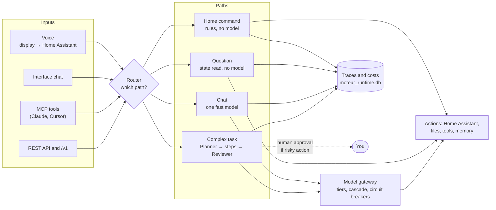

# Understand the engine

> **In one sentence.** The AI Engine is a Python server that receives a request (text, voice through Home Assistant,
> MCP tool, API), picks the **cheapest path that is enough** (rules without a model first, then a fast model,
> then a full orchestration), acts, and traces every call with its cost.

This page explains what happens between sending a request and getting the answer, then gives a tour of the interface. It
needs no prior installation to be read; to try things out, see [01 Install](01_install.md). The technical detail
of the architecture is in [`docs/ARCHITECTURE.md`](../../ARCHITECTURE.md) (French only, June 2026 snapshot), the detail of the API in
[`docs/API_REFERENCE.md`](../../API_REFERENCE.md).

One name only: the **AI Engine** (« Moteur IA » in the interface). You will also meet `vromvrom-engine` (the public repository) and
`tab5-engine` (internal name of the server, visible in `/healthz` and in the name of the MCP server). It is the same software.

---

## 1. What the engine does, in three uses

| Use | What you get | What you need |
|---|---|---|
| **Voice home automation** | « Okay Nabu, allume le salon » ("Okay Nabu, turn on the living room") on a display: Home Assistant transcribes the voice, the engine understands and acts, the answer is spoken and shown. | Home Assistant, a display or a voice satellite: [04](04_home_and_voice.md) |
| **A single door to many models** | The engine picks the model, switches over on failure, uses free quotas, counts tokens and dollars. It also exposes an OpenAI-compatible API (`/v1`) for your tools. | At least one provider key |
| **Agents and automation** | A complex request is split into a plan, run step by step with tools, reviewed, with human approval before risky actions. Background loops consolidate memory or keep watch. | Model keys; be careful with costs: [05 Operate](05_operate.md) |

The engine works **without Home Assistant**: chat, the API, the agents and the MCP server do not depend on it.

---

## 2. Overview



---

## 3. The journey of a request

Every request arrives through `POST /api/execute` (or `/api/execute/stream` for an event stream). It carries a
`user_prompt` and a `source` (`type` and `mode`) that say where it comes from (`api/routes/agents.py`,
`core/source_router.py`):

| `source.type` | Origin |
|---|---|
| `tab5` | Tab5 display |
| `whatsapp` | WhatsApp message |
| `ide` | code editor |
| `voice` | voice |
| `web` | web interface or script |
| `unknown` | other |

The **mode** (`ha`, `chat`, `files`, `default`) steers the processing: `ha` is the home automation agent, `chat` is conversation.

### 3.1 Four paths, from the simplest to the heaviest

| Path | Example | Model called? | Where to tune it |
|---|---|---|---|
| **Home command** | « Allume la lumière du salon. » ("Turn on the living room light.") | No: phrase catalog (`ha_commands.json`), then fuzzy matching of entities | `ha_commands.json` |
| **Question about the home or daily life** | « Quelle heure est-il ? » ("What time is it?"), « Quelle température dans le salon ? » ("What is the temperature in the living room?") | No: state read, weather, clock | nothing to tune |
| **Chat** | « Explique la différence entre un volet et un store. » ("Explain the difference between a shutter and a blind.") | Yes, a fast model, with a fallback cascade | `config.json` → `routing_policy.fast_path_providers` |
| **Complex task** | « Analyse ces journaux et propose un correctif. » ("Analyze these logs and propose a fix.") | Yes, several: Planner, Executor, Reviewer | model tiers, agents, human approval |

The exact order of the shortcuts in the voice modes, with its safeguards, is described in
[`docs/architecture/carte_decision_vocale.md`](../../architecture/carte_decision_vocale.md) (French only). In short:

- `ha` mode: state question, relative air-conditioning adjustment, catalog command, weather or time, then router
  (fuzzy matching, then classification by a model);
- `chat` mode: command, state, weather, time or date, specialists (web, calendar, files), then conversation by a
  model.

Two safeguards to know:

- **A question is not an order**: the test applies to the raw recognized text.
- **Voice never reaches the Planner**: the voice modes do not trigger the full orchestration.

You can see which of these paths a sentence would take **without running anything** with
`POST /api/vocal/simulate` ([04](04_home_and_voice.md), § 4). Tried:

| Sentence | Mode | `chemin` (path) returned | Model required? |
|---|---|---|---|
| « allume la lumière du salon » ("turn on the living room light") | `ha` | `ha_command` (service `light.turn_on`, entity `light.living_room`) | no |
| « quelle heure est-il » ("what time is it") | `chat` | `discussion_datetime` | no |
| « raconte-moi une blague » ("tell me a joke") | `chat` | `discussion_chat` | yes |

### 3.2 The router

`core/router.py` first chooses by **keywords** (no model) among 11 categories: `casual_chat`,
`home_assistant`, `code_generation`, `database`, `files`, `analysis`, `sysadmin`, `deck_edge`, `calendar`, `email`,
`accounts`. If the keywords hesitate:

- a **learned router** (scikit-learn) steps in only if it has been trained and the keyword score is below 0.05; without a
  trained model, it is ignored;
- otherwise a **small model** classifies the request; below 0.7 confidence (`MIN_LLM_CONFIDENCE`), the request goes to the
  Planner.

**Approval guard** (`MOTEUR_ROUTER_GARDE_HITL`, on by default): a request that orders an action does not take the shortcut, so that it
stays subject to approval (§ 7).

---

## 4. Choosing the model: tiers, cascade, circuit breakers

### 4.1 Providers and tiers

- A **provider** (Gemini, DeepSeek, Anthropic, Mistral, Cerebras, OpenRouter…) becomes active when its key is in the
  `.env`. A missing key: it is ignored, without error. List of variables: [03 Settings](03_settings.md).
- The **catalog** (`models_registry.db`, filled by `seed_models_db.py`: 97 models during the test) describes each
  model: provider, price, context, tier.
- The **tiers** (`tiers`) are `leger` (light), `moyen` (medium), `fort` (strong) and `automatique` (automatic). The list of models of a tier comes from the
  **catalog** (adjustable in the **Modèles & routage** (Models and routing) screen); `config.json["tiers"]` is only a safety net.
  `automatique` groups all the active models. `routing_policy.excluded_models` removes models from routing whatever
  the tier.
- Each agent has its model or tier in `config.json`: `planner_model`, `executor_model`, `reviewer_model`,
  `ha_model`, `antigravity_model`.

### 4.2 The cascade

For a tier, the models are ranked (Elo score by domain, cost, remaining quota, latency). If the first one fails,
the next one takes over. The Elo score is adjusted from the reviews (`elo_enabled`, true by default).

The **fast chat** (fast path) follows its own list: `routing_policy.fast_path_providers`. The code fallback
(`services/pipeline_service.py`, lines 83-88) puts an optional local provider first, probed and then skipped if it does not
answer, followed by `gemini-3.5-flash-free`, `deepseek-chat` and `gemini-2.5-flash-free`. Models without a key are
skipped. For requests from the `tab5` source, a dedicated list (`tab_llm_providers`, `gpt-oss-120b` by default)
goes first.

### 4.3 Circuit breakers and health probe

- **Circuit breaker** (`core/llm/circuit_breaker.py`): after **3 consecutive failures**, a model is set aside for
  **30 seconds**; each time it opens again without a success, the delay doubles, up to **30 minutes**. A success resets
  the counter to zero.
- **Gemini key pool** (`core/key_pool.py`): up to six keys (`GEMINI_API_KEY` to `GEMINI_API_KEY_6`) rotate to
  get around the limits; a key that receives a 429 is set aside for 65 seconds.
- **Health probe** (`core/model_health_probe.py`): **on by default**, it sends a real mini-generation to
  each active model every hour. A model that fails three cycles in a row is switched off automatically, then
  re-tested less and less often (down to once a day) and re-enabled if it comes back. Safeguards: nothing is switched off
  if 80% of the attempts of a cycle fail (it is then the network), and never below 5 active models. **It
  consumes real tokens**: to turn it off, `MODEL_HEALTH_PROBE=false` ([05 Operate](05_operate.md), § 6).
- **Budgets** (`BudgetGuard`, `core/budget_guard.py`): daily caps for the autonomous cycle, and a provider
  that failed is paused for 30 minutes. The interactive path is not subject to the daily budget; it is subject to the per-execution
  token cap (`max_session_tokens`, 500,000 by default).
- **Privacy mode**: `MOTEUR_PRIVACY_LEVEL=local_only` uses only local providers and **fails** rather than
  falling back to the cloud.

---

## 5. The agents

| Agent | Role | Setting |
|---|---|---|
| **Planner** (« Planificateur ») | Splits a complex request into steps (a graph, "DAG") and proposes verifiable acceptance criteria ("2 to 4 criteria", `prompts/agents/planner.md`). | `planner_model` |
| **Executor** (« Exécuteur ») | Runs one step: a "think → use a tool → observe" loop. | `executor_model` |
| **Reviewer** (« Relecteur ») | Reviews the result, scores it and feeds the Elo score. | `reviewer_model`, `auto_review` (true by default) |
| **Home automation agent** (`ha_agent`) | Answers in one sentence for voice and controls Home Assistant. | `ha_model` |
| **Prompt Engineer** | Rewrites a messy request into a precise instruction. | `prompt_engineer_model` (default `fort`) |
| **Custom agents** | A clone of the Executor with its own name, tier, instruction and tools. | **Agents** screen; `config.json` → `custom_agents` |
| **ToolMaker** | Generates tool code in a remote sandbox. **Disabled** (`MOTEUR_ENABLE_TOOL_MAKER=0`). | [03](03_settings.md) |
| **Background agents** | Sentinel (« Sentinelle », daemon), Dreamer/DreamCoder, Auditor (« Auditeur »), Vigie. | § 8 |

The **personality** of each agent is a file `prompts/agents/<name>.md` (loaded by `core/prompt_loader.py`): you
can edit it. These files are part of the backup ([05](05_operate.md)).

After a plan, the Reviewer (if `auto_review`) adds one model call per execution: it is a reliability-versus-cost
setting.

---

## 6. Tools, MCP, memory

- **Tools**: read and write files (confined to the working root, `MOTEUR_WORKSPACE_ROOT`, with a write
  guard `MOTEUR_FILE_WRITE_GUARD` on by default), run a command (path guard
  `MOTEUR_TERMINAL_GARDE_CHEMINS` on by default), validate a configuration YAML, query the calendar, Drive,
  Gmail, Home Assistant. In voice mode, the list is reduced to reads.
- **MCP** (Model Context Protocol) works both ways: the engine **offers** 17 tools to Claude or Cursor
  (`mcp_server.py`, [01](01_install.md) § 10) and can **use** third-party MCP servers (`core/mcp_bridge.py`).
- **Memory**:

| Type | Content | Storage |
|---|---|---|
| Facts and episodes | Persistent technical facts, summaries of past sessions | `memory.db` |
| Graph | Entities and relations | `memory.db` |
| Documentation (RAG) | Search by words and by meaning in documents | `chroma_db/` (to be built: `python populate_embeddings.py`) |
| History | Every session, its steps, its calls and their cost | `moteur_runtime.db` |

Without `chroma_db/`, search falls back to lexical search (message of the **Installation** screen). The embeddings
use a Gemini key (`.env.example`). `memory.db` and `moteur_runtime.db` are backed up, `chroma_db/` is not
(`core/sauvegarde.py`).

---

## 7. Human approval (HITL)

Before running a plan, the engine estimates its risk: `low`, `medium`, `high` or `critical` (`core/engine.py`,
`_assess_dag_risk`). The risk comes from a high-impact tool targeted by a step, from an agent with side effects, and, as a
fallback, from keywords in the step label (« supprimer » (delete), "delete", "install", « exécuter » (execute), « déployer » (deploy), « redémarrer » (restart)…
for `high`; « écrire » (write), « modifier » (modify), « créer » (create) for `medium`).

| Rule | Default value | Setting |
|---|---|---|
| Threshold from which approval is requested | `high` | `config.json` → `hitl.seuil_approbation` |
| Autonomous sessions (`daemon_`, `dreamer_`, `routine_`, `maint_`, `task_`) | **Never any approval** (no human) | — |
| Auto-approval of risky plans in an interactive session | No | `hitl.interactive_auto_approve` |
| Waiting | **Non-blocking**: the session is suspended, the plan is stored | `MOTEUR_HITL_NON_BLOQUANT` (1) |

In non-blocking mode, the request is stored durably and waits for your decision. To see it and answer it:

```powershell
$h = @{ Authorization = "Bearer $cle" }
Invoke-RestMethod http://127.0.0.1:8000/api/approval/pending -Headers $h
$corps = @{ request_id = "<identifier>"; feedback = "ok" } | ConvertTo-Json
Invoke-RestMethod -Method Post -Uri http://127.0.0.1:8000/api/approval/approve -Headers $h -ContentType "application/json" -Body $corps
```

`POST /api/approval/reject` rejects. A double click does not replay the plan (the transition is accepted only from
`pending`, `api/routes/approval.py`).

> **Where to approve?** The old interface (`static/`, under `/v1` when `ihm-v2/dist` exists) calls these routes
> (`static/js/tabs/execution.js`). In the React interface, I found no call to `/api/approval` in
> `ihm-v2/src`: use the old interface or the API. `hitl.enabled` and `hitl.timeout_s` of `config.example.json`
> are read by no code in the repository (search by name): see [03](03_settings.md), § 6.

---

## 8. What the engine does on its own

At startup, `gui_server.py` launches background loops. Each one tests its switch at every turn. The
**Avancé** (Advanced) **→ Agents autonomes** (Autonomous agents) screen and the route `GET /api/guide/overview` list their real state.

| Loop | Role | Switch | Consumes tokens? |
|---|---|---|---|
| Live quota stream | Pushes the quota status to the screens (30 s) | none | no |
| Quota refresh | Reads the providers' quotas (300 s) | `QUOTA_REFRESH_INTERVAL_SECONDS` | no |
| Zombie session sweep | Ends sessions left "running" (600 s) | `ZOMBIE_SWEEP_INTERVAL_SECONDS` | no |
| **Model health probe** | Real test of each model, every hour | `MODEL_HEALTH_PROBE` (**yes by default**) | **yes** |
| Quota alert | Warns when a quota or a balance degrades | `QUOTA_ALERTE_ENABLED` (yes by default) | no |
| Sentinel (daemon) | Watches Home Assistant and the system every N minutes | `persistent_agents.daemon_enabled` | no (code comment: “no LLM call”, `core/daemon_loop.py`) |
| Dreamer and DreamCoder | Consolidates memory; moves forward a backlog of code tasks on branches | `persistent_agents.dreamer_enabled` | **yes** |
| Auditor | Audits the code by scope and feeds the backlog | `persistent_agents.auditor_enabled` | **yes** |
| Model and price watch | Compares the price list with public prices (OpenRouter, LiteLLM) every 24 h and **rewrites `pricing_strategy.json`** by default (timestamped backup) | `MOTEUR_VEILLE_ENABLED` (yes by default), `MOTEUR_VEILLE_APPLIQUER` | no (public Internet calls, no key) |
| Vigie | Watches forums, GitHub, YouTube, Gmail; alerts the phone | `MOTEUR_VIGIE_ENABLED` (no by default) | triage by local model only |
| Task discovery | Scans the repository every hour (TODOs in the code, tasks of the `docs/travail/` board) and adds at most 10 tasks per pass to the backlog (`moteur_runtime.db`) | `TASK_DISCOVERY_ENABLED` (yes by default), `TASK_DISCOVERY_MAX_INJECTIONS` | no (no model call found in the code) |
| Remote worker heartbeat | Checks the workers (30 s) | none | no |
| CLI usage scan | Collects conversations of command-line tools | none (no switch) | no |
| MQTT monitoring | Voice failover switch on the Home Assistant side | started if `MQTT_HOST` is defined | no |

> **Privacy of the CLI usage scan.** Every ten minutes, `core/cli_token_collector.py` reads the
> folders `~/.claude/projects/` and `~/.gemini/antigravity-ide/brain/` of the user who launches the engine, and records
> in `moteur_runtime.db` token counters, an "objective" and the project of each conversation of the tools
> installed on the same machine (table `ide_conversations`, `core/session_history.py`). **There is no switch**. If
> you do not want the engine to read these folders, launch it with another account, or do not install these tools on
> the engine's machine. The paths are absent on a machine that has none of them: the scan then finds nothing.

The detail of each loop, its cost and how to turn it off is in [05 Operate, § 6](05_operate.md).

---

## 9. Tour of the interface

Open `http://127.0.0.1:8000/`. The (React) interface is called « Moteur IA » (AI Engine). **The dashboard is in French**; the English meaning of each
menu entry is given in parentheses below. The left menu has five groups (`ihm-v2/src/lib/navigation.ts`). A view with no data
shows "—": the interface never invents a figure.

| Group | Menu entry | Address | What it is for |
|---|---|---|---|
| **Découvrir** (Discover) | Accueil (Home) | `#/accueil` | The engine's verdict in one sentence, its key figures and where to start. |
| | Comprendre le moteur (Understand the engine) | `#/comprendre` | The journey of a request on a clickable map, with « Rejouer une vraie demande » (Replay a real request). |
| | Démo vocale & maison (Voice and home demo) | `#/demo` | From "Okay Nabu" to the action in the house, step by step. |
| | Documentation | `#/documentation` | The mechanisms explained (cascade, budget, agents) and recipes to reduce costs. |
| **Utiliser** (Use) | Chat | `#/chat` | Talk with the engine, which picks the model. |
| | Lancer une tâche (Run a task) | `#/taches` | Hand over an objective, right away or in the queue. |
| | Domotique & vocal (Home automation and voice) | `#/domotique` | Test Home Assistant live, see its scope and the history of voice commands. |
| **Régler** (Configure) | Modèles & routage (Models and routing) | `#/modeles` | Which models are active, at which tier, in which order. |
| | Comptes & coûts (Accounts and costs) | `#/comptes` | Balances, spending and cost per success, provider by provider. |
| | Agents | `#/agents` | Role, model and instruction of each agent. |
| | Outils MCP (MCP tools) | `#/mcp` | The tools the engine offers and those it uses. |
| | Configuration | `#/configuration` | The settings of `config.json`, each with its effect in one sentence. |
| **Surveiller** (Monitor) | Opérations (Operations) | `#/operations` | Version, circuit breakers, quotas and balances in real time. |
| | Observabilité (Observability) | `#/observabilite` | Consumption, costs and sessions over the chosen period. |
| | Sauvegardes (Backups) | `#/sauvegardes` | What is backed up, the last backup, how to restore. |
| | Exécution en direct (Live execution) | `#/execution` | Follow an execution step by step. |
| **Avancé** (Advanced) | Workflows | `#/workflows` | Graphical editor of agent chains. |
| | Prompt Studio | `#/prompts` | Prepare an instruction, estimate its cost, choose the model, send it. |
| | Comparatif modèles (Model comparison) | `#/comparatif` | Observed performance of the models: calls, cost, latency, ranking. |
| | Agents autonomes (Autonomous agents) | `#/autonomes` | The agents that work alone and their pace. |
| | Projets & git (Projects and git) | `#/projets` | The repositories known to the engine, their branch and their policy. |
| | Installation | `#/installation` | Installation checks (calls `GET /api/setup/diagnostics`). |

On the first visit, the interface asks for the `MOTEUR_API_KEY` key; it keeps it in the **browser's** local storage
(`ihm-v2/src/api/client.ts`). Save it only on a browser you trust.

The **Configuration** screen groups the settings into four groups: « Routage & modèles » (Routing and models), « Budgets & garde-fous » (Budgets and safeguards),
« Agents autonomes » (Autonomous agents), « Performance » (`ihm-v2/src/types/config.ts`). It writes to `config.json`; the field-by-field
mapping is in [03 Settings](03_settings.md).

---

## 10. Glossary

| Term | Meaning |
|---|---|
| **Agent** | A role given to a model, with its instruction and its tools. |
| **Cascade** | Ordered list of models: the next one takes over if the previous one fails. |
| **Circuit breaker** (« disjoncteur ») | Sets aside a model that has just failed several times, then retries it. |
| **DAG** | Plan of steps with their dependencies. |
| **Elo** | Score of each model by domain, adjusted from the reviews. |
| **Fast path** | Short path, without planning: rules, then at most one model call. |
| **HITL** | *Human in the loop*: human approval before a risky action. |
| **MCP** | Standard protocol that connects an assistant to tools. |
| **Pipeline Assist** | Home Assistant chain: voice → text, conversation agent, text → voice. |
| **RAG** | Search in documents to feed a model's answer. |
| **Health probe** (« sonde de santé ») | Small real call to each model to know whether it answers. |
| **STT / TTS** | Voice to text / text to voice. |
| **Tier** (« niveau ») | Group of models of a given power and cost. |
| **Zero-model** (« zéro-modèle ») | Answer produced by rules and state reads, without a language model. |

Next: [03 Settings](03_settings.md).
